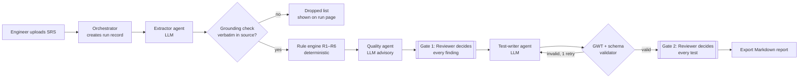
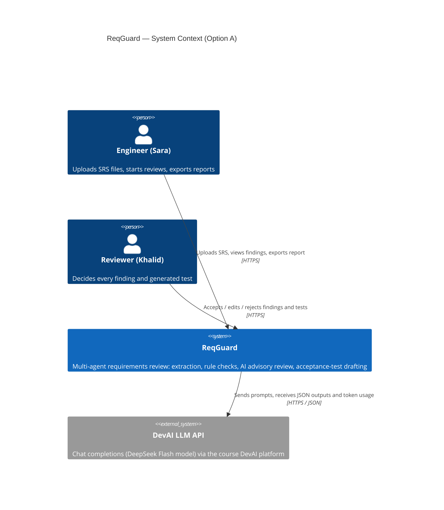
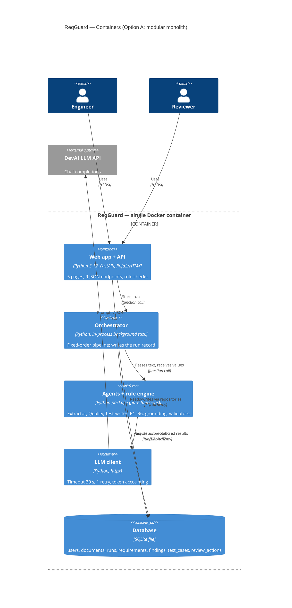
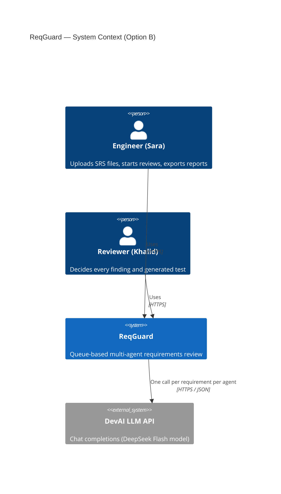
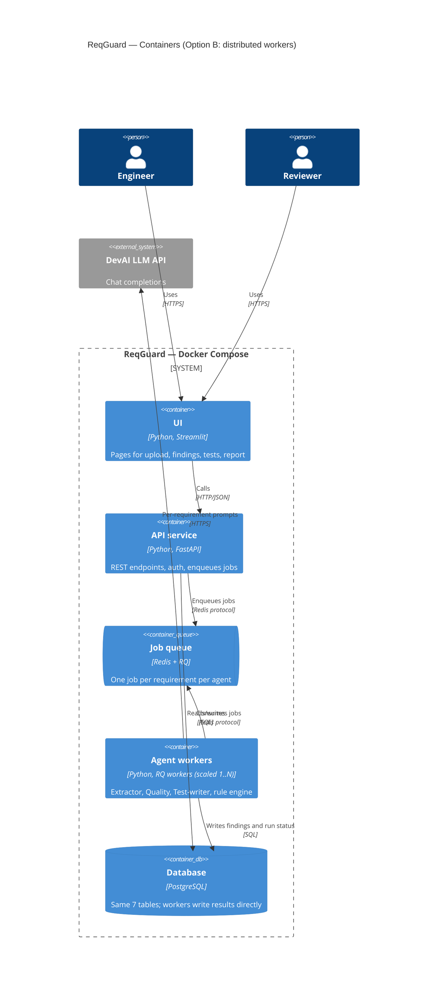

# 05 — Architecture: two options

Process followed (Week 7): generate two deliberately different options → evaluate them against our quality-attribute scenarios (`06_tradeoff_matrix.md`) → check decomposition and coupling (`07_coupling_report.md`) → record decisions as ADRs (`docs/adr/`). The DevAI architecture draft is compared with both options in Section 5.

**Chosen option: A — Modular monolith with batched agents.** See ADR-001.

---

## 1. Shared elements (both options)

### 1.1 Bounded contexts

| Context | Owns (vocabulary and data) | Must not depend on |
|---|---|---|
| Identity | users, roles, sessions | any other context |
| Ingestion | documents (uploaded SRS text) | Analysis, Review, Reporting |
| Pipeline | runs (the shared task record), stage transitions | Review internals, Reporting |
| Analysis | agents, rule engine, grounding check, output validation; produces requirements, findings, test cases as values | storage, Review, Identity, web layer |
| Review | decisions and the audit trail | Analysis internals (uses only finding and test IDs) |
| Reporting | the exported report | writes to any table |
| LLM client | calls to DevAI; token accounting | everything above (pure infrastructure) |

The key boundary: **Analysis is pure**. Agents and rules receive text and return values; they never read or write the database and never call the web layer. Only the Pipeline persists their results. This is what keeps the rule engine and agents mutation-testable with a mocked LLM.

### 1.2 Agents (roles, tools, inputs/outputs, handoffs, stopping conditions)

| Agent | Role | Permitted tools | Input | Output (schema-validated JSON) | Hands off to | Stopping conditions | Human approval point |
|---|---|---|---|---|---|---|---|
| Extractor | Split the SRS into individual requirements | DevAI chat completion only. No file system, no network beyond the LLM client, no database | Document text with line numbers | `[{id, text, line}]` | Grounding check (deterministic) → Rule engine | Valid schema; or 1 retry then *Failed – retryable*; hard cap 8,000 output tokens | None (output is filtered by the grounding check, not trusted) |
| Quality | Judge ambiguity and testability; propose rewrites | DevAI chat completion only | Grounded requirements + the rule findings already raised | `[{req_id, problem, explanation, suggested_rewrite}]`, labelled *AI advisory* | Review queue | Valid schema; or 1 retry then *Failed – retryable* (rule findings are kept); cap 8,000 output tokens | **Gate 1:** reviewer decides every finding before tests are generated |
| Test-writer | Draft Given–When–Then acceptance tests | DevAI chat completion only | Requirement text after reviewer decisions (edited text if edited) | `[{req_id, given, when, then}]` | GWT validator → Review queue | Valid schema and GWT check; or 1 retry then *Failed – retryable*; cap 8,000 output tokens | **Gate 2:** reviewer decides every test before export |

Deterministic components (not agents): **Grounding check** (FR-03), **Rule engine R1–R6** (FR-04), **Output validator** (FR-07). The **Orchestrator** is deterministic code with a fixed order; no agent chooses the next agent. Agents never see each other's prompts; they share only the task record values the orchestrator passes on.

### 1.3 Pipeline flow (both options)

---

## 2. Option A — Modular monolith, batched agent calls (CHOSEN)

**Shape:** one Python process (FastAPI) serves server-rendered pages (Jinja2 + HTMX) and the JSON API. The orchestrator runs each review in-process as a background task. Each agent makes **one batched LLM call per document** (chunks of at most 40 requirements). SQLite stores everything through one repository layer. Deployed as **one Docker container** on one host.

### 2.1 C4 Level 1 — System Context (Option A)

### 2.2 C4 Level 2 — Containers (Option A)

**Why it fits:** one deployable, no queue to operate, batched calls minimise tokens (NFR-06), and the pure Analysis package is easy to unit-test and mutation-test.
**Known weakness:** one process; a crash mid-run loses the in-flight stage (the run is marked *Failed – retryable* on restart). No horizontal scaling.

---

## 3. Option B — Distributed workers, per-requirement fan-out (REJECTED)

**Shape:** a Streamlit UI talks to a separate FastAPI service. Starting a run enqueues jobs on Redis. Separate worker processes (RQ) run each agent; the Quality and Test-writer agents are called **once per requirement**, in parallel across workers. PostgreSQL holds the shared task record. Deployed as **five containers** with Docker Compose (UI, API, worker × N, Redis, PostgreSQL).

### 3.1 C4 Level 1 — System Context (Option B)

### 3.2 C4 Level 2 — Containers (Option B)

**Strengths:** lower wall-clock latency on large documents through parallel workers; a worker crash loses one job, not a run.
**Weaknesses:** five containers to operate; per-requirement calls repeat the system prompt for every requirement, multiplying input tokens (see `08_cost_model.md`); workers writing directly to the database couple Analysis to storage.

---

## 4. Distinctness check

Two options are "genuinely distinct" only if they differ in structural decisions, not just technology names.

| Dimension | Option A | Option B | Different? |
|---|---|---|---|
| Deployment units | 1 container | 5 containers (UI, API, workers, Redis, PostgreSQL) | Yes |
| Communication style | In-process function calls, synchronous within a background task | Asynchronous messages through a queue | Yes |
| LLM call strategy | Batched: 1 call per agent per document (≤ 40 requirements per chunk) | Fan-out: 1 call per requirement per agent | Yes |
| Persistence | SQLite, single writer (orchestrator) | PostgreSQL, many writers (API + workers) | Yes |
| Failure unit | Whole run (retry the stage) | Single job (retry one requirement) | Yes |
| Frontend | Server-rendered HTML from the same app | Separate Streamlit app | Yes |

Six of six structural dimensions differ, so the options are not variations of one idea.

---

## 5. Comparison with the DevAI architecture draft

Source: Prompt 2 output, saved unedited as `docs/ai_drafts/devai_architecture_draft.md`, encoded as `architecture/devai_draft.json` exactly as drawn (no fixes) and checked with the same coupling rules.

**What DevAI proposed:**
- A React SPA, a FastAPI gateway with separate ingestion, review, audit and exporter services, and a Celery worker pool on Redis.
- PostgreSQL, S3/MinIO object storage, and LiteLLM with failover to other model providers.
- Four agents (Extractor, Flagging, Rewrite, Acceptance-test), with flagging and test generation fanned out **one task per requirement**.

The draft is closest to our Option B, but larger.

| Aspect | DevAI draft | Option A (chosen) | Option B | What we kept / rejected and why |
|---|---|---|---|---|
| Deployment units | 7 (SPA, API, Celery workers, PostgreSQL, Redis, S3/MinIO, external LLM via LiteLLM) | 1 | 5 | **Rejected.** The brief allows one deployment target and warns against heavy infrastructure; S3 and a separate SPA build add nothing for `.txt` uploads of ≤ 200 KB. |
| Agents | 4: Extractor, Flagging, Rewrite, Acceptance-test | 3: Extractor, Quality (flag + rewrite), Test-writer | 3 | **Merged** Flagging and Rewrite into one Quality agent: one call per document instead of two, and the rewrite sees the exact reason for the flag. |
| LLM call strategy | Per-requirement fan-out for flagging and tests ("a 500-item doc becomes 500 tasks") | Batched (ADR-003) | Fan-out | **Rejected.** Fan-out fails NFR-06: 71,720 vs 14,894 tokens per 40-requirement run (`08_cost_model.md`). The 500-item / 60 s target it serves was itself rejected in the correction log. |
| Ambiguity detection | AI judgment only | Rules R1–R6 first, AI advisory (ADR-002) | Same as A | **Rejected** AI-only: not repeatable and no exact oracle. |
| Guard against invented requirements | None | Verbatim grounding check (ADR-004) | Same as A | **Added** by us; the draft has no step that checks extraction against the source. |
| Who writes to the database | Orchestrator, Flagging agent, Acceptance-test agent, Review service and Exporter (re-import) | Orchestrator only, plus Review appending decisions | API + workers | **Rejected.** 8 coupling violations (below). |
| Agent handoffs | One shared persisted Pydantic `RequirementItem`, enriched by each stage | Orchestrator passes typed values; agents never persist | Queue messages | **Kept** the idea of one typed shared schema (our mitigation for prompt/schema coupling, `07_coupling_report.md` §5), but agents do not write it themselves. |
| LLM provider | LiteLLM with automatic failover to other providers (GPT / Claude / self-hosted) | DevAI only, through one client | DevAI only | **Rejected.** Automatic failover would send SRS text to tools the course has not approved (brief: approved tool DEVAI). |
| Failure handling | "Degraded but honest": failed item stays pending, never a fabricated result | Stage marked *Failed – retryable*; rule findings kept (NFR-07) | Job-level retry | **Kept** the principle. |
| Audit trail | Append-only tables enforced by DB grants and triggers | Append-only `review_actions`, no update/delete route (FR-09) | Same | **Kept** the append-only principle; DB-level triggers are not available in the same form in SQLite, so enforcement is in the repository layer and tested (T-23). |
| Human approval points | Review after all stages (tests generated before any decision) | 2 gates: findings, then tests | 2 gates | **Revised.** Tests are generated only after findings are decided, so they target the reviewer's final text. |
| Coupling check | **FAIL — 8 violations** | **PASS** | FAIL — 7 | See `reports/coupling_run.txt` and `07_coupling_report.md`. |
