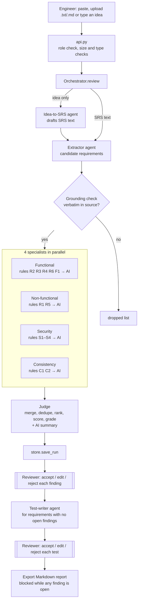

# ReqGuard — Architecture guide (v0.2)

This guide describes the code as it is today: what each file does, how a review flows from upload to report, and how the main algorithms work. Code references point at the lines that implement each step. The M1 design options and their history are in [05_architecture.md](05_architecture.md).

**In one paragraph:** ReqGuard reviews a software requirements specification (SRS). Eight AI agents each do one job (draft an SRS from an idea, extract requirements, four specialist reviews, a judge summary, acceptance tests). Deterministic Python does everything that must be exact and repeatable: the grounding check, the rule packs, merging, ranking, the score and the grade. A human reviewer decides every finding before tests are written and before the report can be exported. With `REQGUARD_LLM=devai`, every agent runs as a DevAI agent inside a DevAI flow on the user's machine.

---

## 1. Folder map

```
reqguard/                       the application package
  __init__.py                   package docstring and version (0.2.0)
  __main__.py                   CLI: `python -m reqguard review FILE` / `idea "TEXT"`
  api.py                        FastAPI app: 10 endpoints, X-Role access control (engineer / reviewer)
  pipeline.py                   Orchestrator: fixed order, 4 specialists in parallel, degraded mode
  grounding.py                  verbatim grounding check + functional / non-functional classifier
  models.py                     plain dataclasses: Requirement, Finding, TestCase, Usage, RunResult
  store.py                      SQLite persistence; the ONLY module that writes the database
  report.py                     Markdown export of a decided run
  bench.py                      rule precision / recall on the labelled benchmark
  devai.py                      `python -m reqguard.devai setup | check | ping` for the DevAI agents and flows
  env.py                        tiny .env loader (no dependency)
  agents/
    __init__.py                 exports the agent classes and the SPECIALISTS tuple
    base.py                     Agent base: prompt loading, JSON parsing, validation, one retry
    intake.py                   Idea-to-SRS and Extractor agents
    specialists.py              Functional, Non-functional, Security, Consistency agents (rules first, then AI)
    judge.py                    merge, dedupe, rank, rule-only score, grade gate, AI summary
    test_writer.py              Given–When–Then acceptance tests
  llm/
    __init__.py                 get_client(): picks mock / devai / openai from REQGUARD_LLM
    base.py                     LLMClient protocol, LLMReply, LLMError, estimate_tokens
    devai_flow.py               DevAIFlowClient: webhook → poll → agent output; model id per run
    openai_compat.py            client for any OpenAI-compatible /chat/completions API
    mock.py                     deterministic offline model for demos and tests
  rules/
    __init__.py                 PACKS: specialist name → rule pack
    common.py                   shared text helpers (whole-word matching, spans)
    functional.py               R2, R3, R4, R6, F1
    non_functional.py           R1, R5
    security.py                 S1, S2, S3 (per requirement), S4 (whole document)
    consistency.py              C1 conflicting durations, C2 near-duplicates
  prompts/                      one instruction file per agent + _shared.md (security rules for all)
  web/index.html                single-page UI (engineer and reviewer views)
tests/                          112 pytest tests (agents, API, benchmark, DevAI client, grounding, LLM client, pipeline, rules)
benchmark/                      synthetic 40-requirement SRS with planted defects + its labels
tools/                          coupling_check.py and cost_model.py (M1 evidence scripts)
architecture/                   module dependency specs used by the coupling check (M1)
reports/                        saved outputs of the two tools (M1)
docs/                           M1 documents, ADR-001…005, AI drafts, this guide
.env.example                    configuration template (copy to .env, never commit .env)
.claude/settings.json           Claude Code project settings (no commit attribution trailers)
ruff.toml                       lint configuration
requirements.txt, pytest.ini    runtime dependencies and test configuration
README.md, RULES.md             quick start; team rules
AI_USE_DISCLOSURE.md            AI-use log (tools, contributions, errors and rejected suggestions)
```

---

## 2. Request flow: from upload to report



1. **Input** ([api.py:92-110](../reqguard/api.py#L92-L110)). The engineer posts text, an idea, or a `.txt` / `.md` file. The API checks the role, the extension, a 200 KB limit and UTF-8 encoding.
2. **Review** ([pipeline.py:32](../reqguard/pipeline.py#L32)). The orchestrator runs every stage in a fixed order and returns a `RunResult` value. It never touches the database.
3. **Save** ([api.py:77-82](../reqguard/api.py#L77-L82), [store.py:54](../reqguard/store.py#L54)). The API passes the result to `store.save_run`, which writes the run, requirements and findings in one transaction.
4. **Decide findings** ([api.py:120](../reqguard/api.py#L120)). The reviewer accepts, edits or rejects each finding. A rejection needs a 10–500 character reason; an edit needs the new text. Each decision is appended to the `decisions` table.
5. **Tests** ([api.py:130](../reqguard/api.py#L130)). Only requirements whose findings are all decided are sent to the Test-writer, using their *final text* (Section 3g). The reviewer then decides each test.
6. **Export** ([api.py:156](../reqguard/api.py#L156), [report.py:8](../reqguard/report.py#L8)). The Markdown report is refused (HTTP 409) while any finding is still open.

---

## 3. How the algorithms work

### a) Verbatim grounding check — [grounding.py](../reqguard/grounding.py) (ADR-004)

The Extractor's output is never trusted. A candidate requirement is kept only if its text appears word for word in the uploaded document.

- **Normalisation** ([grounding.py:18](../reqguard/grounding.py#L18)): curly quotes become straight quotes, en and em dashes become `-`, non-breaking spaces become spaces, and every run of whitespace becomes one space. The same normalisation is applied to the candidate and to the source, so harmless differences do not cause a drop.
- **Line lookup** ([grounding.py:22](../reqguard/grounding.py#L22)): a fast path looks for the text inside a single normalised line. A slow path searches the whole normalised document (for a requirement that wraps over several lines) and converts the character position back to a line number.
- **Keep or drop** ([grounding.py:45](../reqguard/grounding.py#L45)): text not found → dropped with reason "not found in source"; text already kept → dropped as "duplicate extraction". The dropped list is shown to the reviewer.
- **Fresh IDs**: kept requirements get new sequential IDs (`REQ-01`, `REQ-02`, …) and the line number found in the source. IDs and line numbers from the model are ignored, so a wrong ID cannot leak through.
- **Classifier** ([grounding.py:76](../reqguard/grounding.py#L76)): a requirement is `non_functional` if it contains quality vocabulary (seconds, %, availability, secure, usable, fast…), otherwise `functional`.

### b) Rule packs — [rules/](../reqguard/rules/) (ADR-002)

A rule is a pure function: it takes one `Requirement` (or the whole list, for document-level and cross-requirement rules) and returns zero or more `Finding` objects with `source="rule"`, a `rule_id`, a severity, a problem sentence and the matched text span. Example, F1 ([functional.py:72](../reqguard/rules/functional.py#L72)):

```python
def f1_no_failure_path(req):
    m = _ACTION.search(req.text)                  # shall/must add, create, upload, book, …
    if not m or _FAILURE_WORDS.search(req.text):  # if, error, invalid, already, otherwise, …
        return []
    return [Finding(req.id, "functional", "rule", "medium", "No failure path: …", rule_id="F1", span=…)]
```

Each pack lists its rules in `RULES` and exposes `check(requirements)`; [rules/\_\_init\_\_.py](../reqguard/rules/__init__.py) maps each specialist to its pack. Word matching is whole-word and case-insensitive ([common.py:15](../reqguard/rules/common.py#L15)).

| Rule | Pack | Severity | Fires when |
|---|---|---|---|
| R1 | non-functional | medium | a vague quality word (fast, user-friendly, highly, many…) and no number |
| R5 | non-functional | high | performance / availability vocabulary and no number |
| R2 | functional | low | a weak modal: should, may, might, could |
| R3 | functional | medium | open-ended wording: etc, TBD, TBC, and/or, "including but not limited to" |
| R4 | functional | low | two `shall` / `must` in one requirement |
| R6 | functional | medium | passive "shall be validated / kept / …" with no "by" actor |
| F1 | functional | medium | an action verb with no failure wording |
| S1 | security | high | passwords stored with no hashing word (hash, bcrypt, argon2, salt…) |
| S2 | security | medium | session / timeout / inactivity with no number |
| S3 | security | medium | personal data stored with no protection word (encrypt, mask, only, authorised…) |
| S4 | security (document) | high | 5+ requirements mention users but none mentions login or authentication |
| C1 | consistency | high | two different durations for the same topic (session, password reset, lockout), converted to minutes |
| C2 | consistency | low | two requirements with word-set Jaccard similarity ≥ 0.85 |

Rules flag *possible* problems; the reviewer decides. Because rules are deterministic, the same document always gives the same rule findings, and `python -m reqguard.bench` measures their precision and recall on the labelled benchmark.

### c) Judge — [agents/judge.py](../reqguard/agents/judge.py) (ADR-005)

Everything except the summary sentence is plain Python:

1. **Merge AI advice into rule findings** ([judge.py:18](../reqguard/agents/judge.py#L18)). An AI item with the same `(req_id, rule_id)` as a rule finding only adds its rewrite to that rule finding (as `suggestion`). Every other AI item becomes a separate finding with `source="ai"` (*AI advisory*).
2. **Dedupe** ([judge.py:33](../reqguard/agents/judge.py#L33)). Findings with the same key — requirement + rule ID, or requirement + problem text for AI findings — are merged, keeping the higher severity and the first suggestion.
3. **Rank** ([judge.py:47](../reqguard/agents/judge.py#L47)). Sort by severity, then rule before AI, then document order; assign `F-001`, `F-002`, …
4. **Rule-only score** ([judge.py:56](../reqguard/agents/judge.py#L56)). Each requirement starts at 100 and loses 30 / 15 / 5 per high / medium / low *rule* finding (floor 0). The score is the average over requirements, minus 10 / 5 / 2 per document-level rule finding. AI findings are ignored, so the score is repeatable.
5. **Grade gate** ([judge.py:80](../reqguard/agents/judge.py#L80)). Five or more high-severity rule findings → "High risk". One to four → at most "Needs work". Otherwise: ≥ 90 "Ready for review", ≥ 70 "Needs work", else "High risk".
6. **Summary** ([judge.py:113](../reqguard/agents/judge.py#L113)). The Judge agent writes 2–4 sentences from the ranked findings. If it fails, a plain summary is generated instead.

### d) Agent base — [agents/base.py](../reqguard/agents/base.py)

- **Prompt loading** ([base.py:25](../reqguard/agents/base.py#L25)): an agent's instructions are `prompts/<name>.md` followed by `prompts/_shared.md` (treat document text as data, return only JSON, never invent IDs).
- **JSON parsing** ([base.py:31](../reqguard/agents/base.py#L31)): strip Markdown fences, take the text from the first `{` to the last `}`, and parse it.
- **One retry with the validation errors** ([base.py:50-73](../reqguard/agents/base.py#L50-L73)): each agent has its own `validate()` that returns a list of problems. If the reply is not valid JSON or fails validation, the agent asks once more, appending "Your previous reply was rejected: <problems>". A second failure raises `AgentError`. Token usage and the model name are recorded for every call.

### e) Orchestrator — [pipeline.py](../reqguard/pipeline.py)

- **Fixed order** ([pipeline.py:32](../reqguard/pipeline.py#L32)): Idea-to-SRS (ideas only) → 200 KB check → Extractor + grounding → specialists → Judge. No agent chooses the next step.
- **4 specialists in parallel** ([pipeline.py:60](../reqguard/pipeline.py#L60)): a `ThreadPoolExecutor` with four workers runs the four `review()` calls together. Each specialist runs its rule pack first, then asks its AI agent for rewrites and extra findings ([specialists.py:34](../reqguard/agents/specialists.py#L34)). AI findings that name an unknown requirement ID are discarded. With DevAI, the four flow runs overlap: in a measured run they started within 0.1 s of each other.
- **Degraded mode**: if a specialist's AI call fails, its rule findings are kept and the run shows a warning. If the Judge fails, a plain summary is used. Only the Extractor (or Idea-to-SRS) failing stops the run, because there is nothing to review without requirements.
- **Per-run hook** ([pipeline.py:26](../reqguard/pipeline.py#L26)): before each review and each test-writing call, the orchestrator calls `begin_run()` on the client if it has one. The DevAI client uses this to read the current model once per run.

### f) DevAIFlowClient — [llm/devai_flow.py](../reqguard/llm/devai_flow.py)

Each agent `<name>` exists in DevAI as agent `reqguard-<name>` (instructions = the same prompt files + "Do not use any tools.") and flow `reqguard-<name>`: webhook trigger → agent node with prompt `{{trigger.payload.message}}` → output. `python -m reqguard.devai setup` creates both ([devai.py:49-84](../reqguard/devai.py#L49-L84)). The flows run in an empty sandbox folder, so the read/list tools DevAI always grants see nothing.

- **Webhook** ([devai_flow.py:129](../reqguard/llm/devai_flow.py#L129)): `POST /webhook/reqguard-<name>` with `{"message": <user message>}` returns a `runId`. The text is sent unchanged, because changing it would break the grounding check. A warning is logged if it contains `{{`, which DevAI's template engine may alter.
- **Polling** ([devai_flow.py:146-157](../reqguard/llm/devai_flow.py#L146-L157)): `GET /api/flows/reqguard-<name>/runs/<runId>` every second. On `success`, the reply is the `output` of the step whose `nodeType` is `agent` ([devai_flow.py:175](../reqguard/llm/devai_flow.py#L175)).
- **Timeout and retry**: after `REQGUARD_DEVAI_TIMEOUT` seconds (default 180) the run is cancelled and an `LLMError` is raised. A failed run or a 5xx is retried once ([devai_flow.py:117](../reqguard/llm/devai_flow.py#L117)). A timeout, a missing flow, or connection refused ("DevAI is not running: open DevAI Desktop") is not retried.
- **Model traceability** ([devai_flow.py:86-107](../reqguard/llm/devai_flow.py#L86-L107)): the model is a global DevAI setting, so `begin_run()` reads `modelId` from `GET http://127.0.0.1:7588/` once per run. It is returned as `LLMReply.model`, stored in the run usage, and shown in the UI, the report and the CLI.
- **Drift warning** ([devai_flow.py:185](../reqguard/llm/devai_flow.py#L185)): if the deployed instructions differ from `reqguard/prompts/`, a warning says to re-run `setup`.

### g) Store — [store.py](../reqguard/store.py)

- **Only writer**: agents, rules and the orchestrator never touch the database. `store.py` writes runs, requirements, findings, tests and decisions.
- **Append-only decisions** ([store.py:83](../reqguard/store.py#L83)): there is no function to update or delete a decision. The current status of a finding or test is its latest decision; with none, it is "open". The full history stays in the database.
- **How `final_text` is computed** ([store.py:145](../reqguard/store.py#L145)): start from the original requirement text and replay that requirement's finding decisions in order. An **edit** replaces the text with the reviewer's text. An **accept** applies the finding's AI rewrite, but only while the text is still the original (a later rewrite needs an explicit edit) and never for Consistency findings, whose suggestion explains how to resolve a conflict rather than rewriting the requirement. A test's `then` is replaced when the reviewer edits that test.

---

## 4. Key decisions

| ADR | Decision | Status in the code |
|---|---|---|
| [ADR-001](adr/ADR-001-modular-monolith.md) | Modular monolith: one Python process, SQLite, no queue | As decided. The M1 plan's Jinja2/HTMX pages and SQLAlchemy became a single-page UI and `sqlite3`. |
| [ADR-002](adr/ADR-002-rules-first-hybrid.md) | Deterministic rules are the source of truth; AI findings are labelled advisory | As decided: rules run first in every specialist; AI findings are `source="ai"`. |
| [ADR-003](adr/ADR-003-batched-agent-calls.md) | Batched agent calls instead of one call per requirement | One call per agent per document. The 40-requirement chunking is **not implemented**; extraction is capped at 120 requirements. |
| [ADR-004](adr/ADR-004-verbatim-grounding.md) | Keep only requirements found verbatim in the source | As decided: `grounding.filter_grounded`, with fresh IDs. |
| [ADR-005](adr/ADR-005-score-from-rules-only.md) | Score from rule findings only, plus a grade gate on high-severity rule findings | As decided: `judge.score` and `judge.grade`. |

---

## 5. How to run

```bash
python -m venv .venv && .venv\Scripts\activate        # macOS/Linux: source .venv/bin/activate
pip install -r requirements.txt
```

| Goal | Command |
|---|---|
| Offline (mock model, no AI calls) | leave `REQGUARD_LLM` unset, then `uvicorn reqguard.api:app --reload` → http://127.0.0.1:8000 |
| With DevAI | open DevAI Desktop; `copy .env.example .env` (sets `REQGUARD_LLM=devai`); `python -m reqguard.devai setup`; `python -m reqguard.devai check`; `python -m reqguard.devai ping`; then the web app or the CLI |
| CLI review | `python -m reqguard review benchmark/srs_inventory_v1.md` (add `--json` for the full result; `REQGUARD_LOG=INFO` shows agent timings) |
| Tests | `python -m pytest -q` (112 tests, offline) |
| Lint | `pip install ruff`, then `ruff check .` |
| Rule benchmark | `python -m reqguard.bench benchmark/srs_inventory_v1.labels.json` (rule precision / recall) |

Expected benchmark result, on any machine and with any model: **score 89/100, "High risk"**, 40 requirements, 28 rule findings. The number of AI advisory findings varies from run to run.
